<div align="center">

# SparseHPS

### A Unified Model for Human Pose and Shape across Depth Cameras and LiDARs

[Ilya Zaychuk](https://www.linkedin.com/in/ilya-zaychuk)

[](https://ghostlate.github.io/SparseHPS/)
[](https://ghostlate.github.io/SparseHPS/)
[](https://ghostlate.github.io/SparseHPS/#humanoid)

<a href="https://ghostlate.github.io/SparseHPS/#humanoid">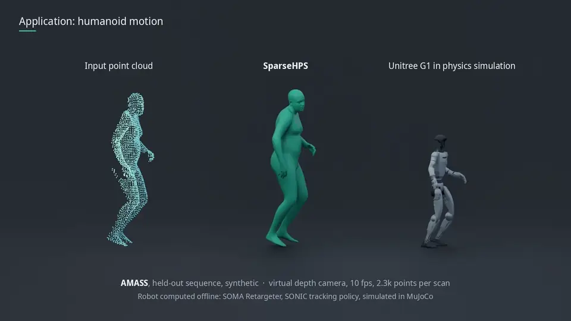</a>

<sub>Input cloud (2 cm voxels, as the model reads it) → SparseHPS-T estimate → Unitree G1 via kinematic retargeting
(GMR). Test sequences of AMASS, BEDLAM2, FreeMotion, HuMMan and RELI11D.</sub>

</div>

**One network, one set of weights:** SMPL-X pose, shape and metric global translation from the point cloud of any
depth camera or LiDAR, for single frames and streams alike, in 10 ms per frame.

## Highlights

| | Sensor | J-Err(L) | |
|---|---|---:|---|
| **SLOPER4D** | moving LiDAR | **28.6 mm** | −22% vs. the best 32-frame method |
| **FreeMotion** | static LiDARs | **41.8 mm** | −11% vs. the best 32-frame method |
| **HuMMan** | real Azure Kinect | **34.7 mm** | 42 held-out subjects |
| **Speed** | | **10 ms** | per cloud on an RTX 4090, 50.0M parameters |

- **Sensor-agnostic.** Point density differs by more than ten times between devices; one set of weights serves depth
  cameras and LiDARs.
- **Single frames and streams.** A causal memory of tokens from the seven preceding frames adds temporal context; the
  current frame alone already gives the bulk of the accuracy.
- **Ten datasets, one body model.** Rendered clouds and real depth-camera and LiDAR captures, all converted to the
  neutral locked-head SMPL-X with 16 shape coefficients.

## Abstract

Recovering 3D human pose and shape from point clouds is central to motion capture, robotics and self-driving vehicles,
because depth cameras and LiDARs sense a person directly in metric 3D and work under any lighting. However, current
approaches are each tailored to one sensor type: point density differs by more than ten times between devices, public
datasets are labeled with incompatible body models, and LiDAR approaches need long input sequences to offset sparse
scans. In this work, we present SparseHPS, a novel sensor-agnostic network that recovers SMPL-X pose, shape and global
translation from a human point cloud with one set of weights, for single frames and streams alike. Specifically,
SparseHPS encodes the cloud with a LitePT backbone over sparse voxels, represents every joint by a learnable query
decoded with one common head, localizes the body by voting over voxels, and draws temporal context from a causal
memory of tokens from the seven preceding frames. A single model is trained on ten datasets that mix rendered clouds
with real depth-camera and LiDAR captures, all converted to one body model. Experiments demonstrate state-of-the-art
results on the SLOPER4D and FreeMotion LiDAR benchmarks, where SparseHPS lowers the root-relative joint error by 22%
and 11%, respectively, compared with the strongest prior method, which needs 32 frames. On real Azure Kinect captures
of held-out HuMMan subjects, SparseHPS attains a joint error of 34.7 mm. Moreover, the current frame alone already
yields the bulk of this accuracy.

## Method

<p align="center">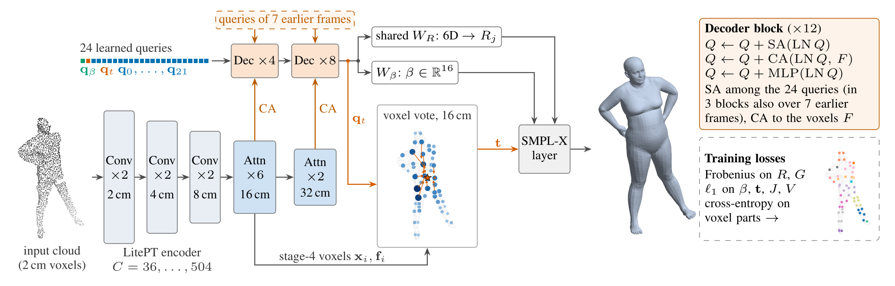</p>

A LitePT encoder turns the cloud (2 cm voxels) into sparse voxel features. Twenty-four learned queries (shape,
translation and one per joint) cross-attend to them in twelve decoder blocks; three blocks also attend to the queries
of the seven preceding frames (a causal memory). A shared head maps every joint query to a rotation, voxels vote for
the body position, and an SMPL-X layer gives the mesh.

## Results

<p align="center">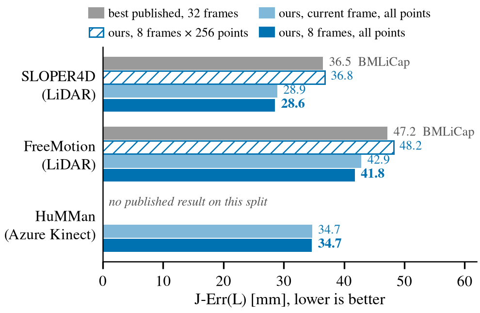</p>

<details>
<summary><b>Comparison tables from the paper</b> (LiDAR benchmarks and HuMMan-Point)</summary>
<br>
<p align="center">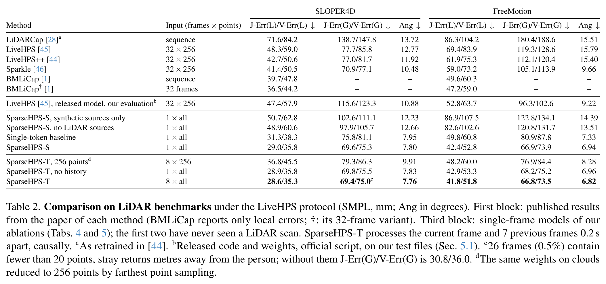</p>
<p align="center">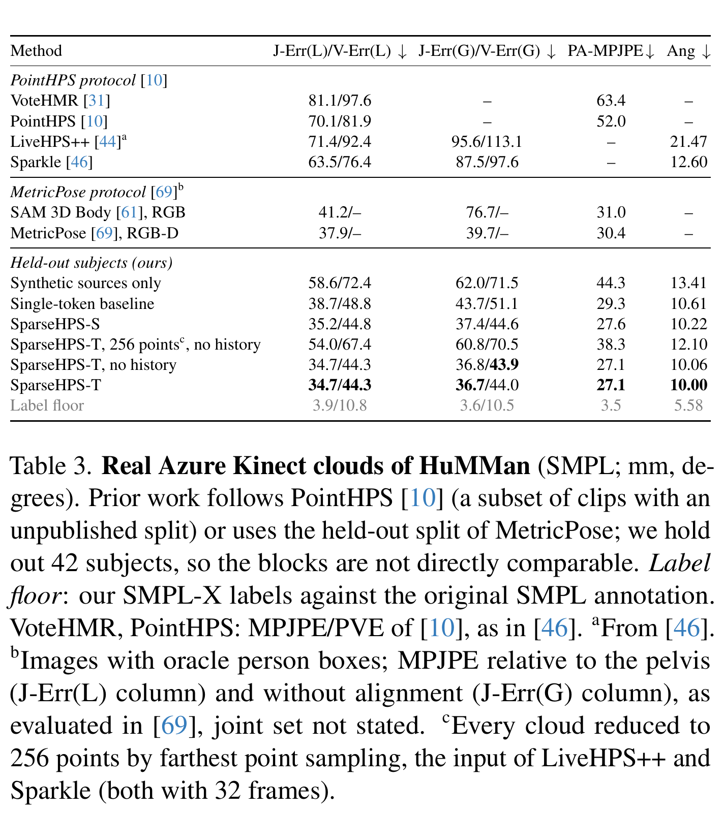</p>
<sub>Numbers in brackets refer to the paper's references.</sub>
</details>

## From a point cloud to a humanoid

Every clip runs the same SparseHPS-T model on a test sequence and hands its SMPL-X motion to a Unitree G1 through
kinematic retargeting ([GMR](https://github.com/YanjieZe/GMR)); the model never sees the robot. The body and the robot
are rendered in NVIDIA Isaac Sim. The videos are on the
[project page](https://ghostlate.github.io/SparseHPS/#humanoid).

<table>
<tr>
<td><a href="https://ghostlate.github.io/SparseHPS/#humanoid">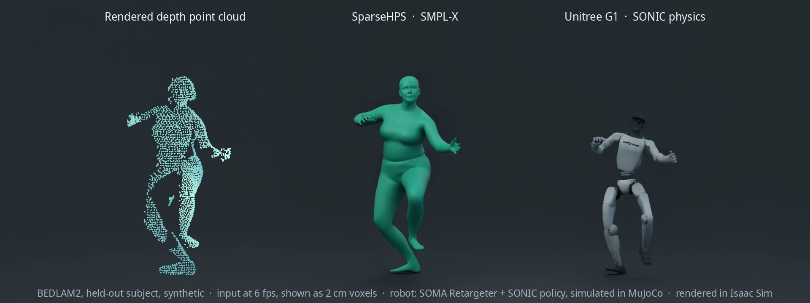</a><br><sub>BEDLAM2, rendered depth</sub></td>
<td><a href="https://ghostlate.github.io/SparseHPS/#humanoid">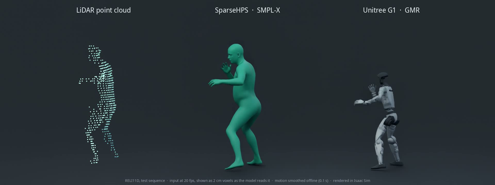</a><br><sub>RELI11D, static LiDAR, boxing</sub></td>
</tr>
<tr>
<td><a href="https://ghostlate.github.io/SparseHPS/#humanoid">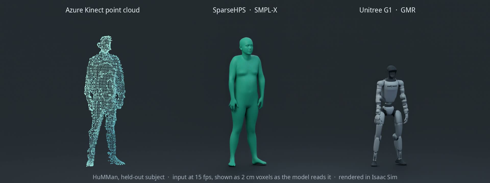</a><br><sub>HuMMan, Azure Kinect</sub></td>
<td><a href="https://ghostlate.github.io/SparseHPS/#humanoid">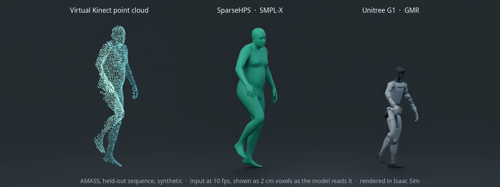</a><br><sub>AMASS, virtual Kinect</sub></td>
</tr>
<tr>
<td><a href="https://ghostlate.github.io/SparseHPS/#humanoid">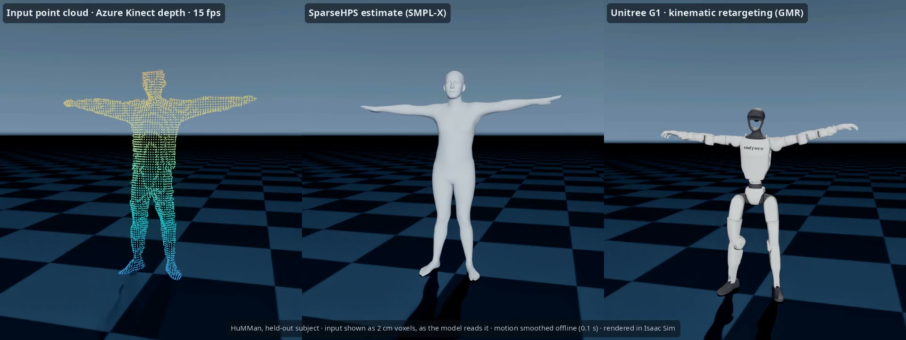</a><br><sub>HuMMan, Azure Kinect</sub></td>
<td><a href="https://ghostlate.github.io/SparseHPS/#humanoid">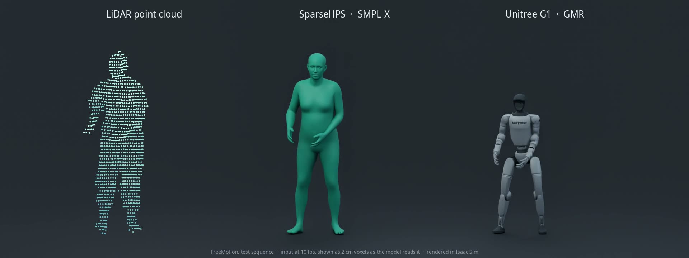</a><br><sub>FreeMotion, static LiDAR</sub></td>
</tr>
</table>

## Citation

```bibtex
@article{zaychuk2026sparsehps,
  title   = {SparseHPS: A Unified Model for Human Pose and Shape across Depth Cameras and LiDARs},
  author  = {Zaychuk, Ilya},
  journal = {arXiv preprint},
  year    = {2026}
}
```

## Acknowledgements

The datasets, the SMPL-X body model, the robot model and the tools behind the demo are credited in the
[Datasets and acknowledgements](https://ghostlate.github.io/SparseHPS/#credits) section of the project page. The demo
videos show data of these datasets; their reuse is subject to the datasets' licenses.
